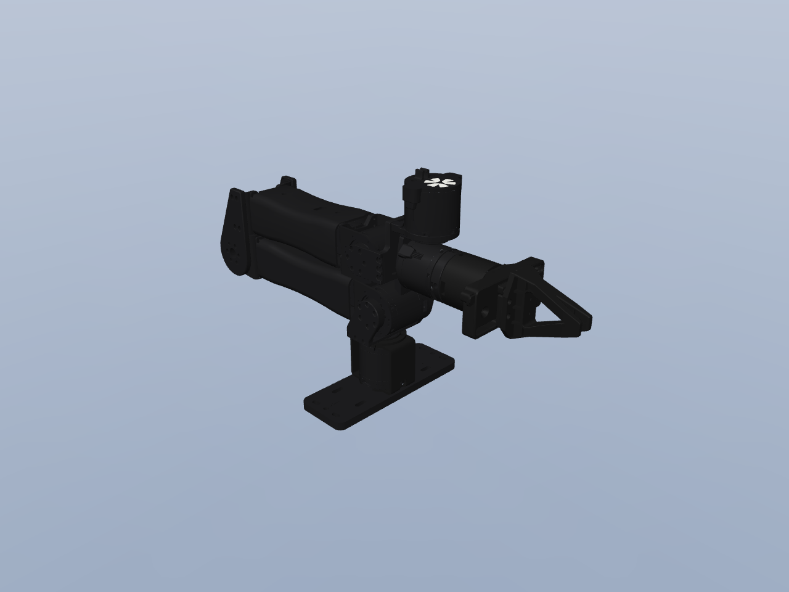

# openyam_single — URDF

| file | what |
|---|---|
| `openyam_single.urdf` | the robot: 10 links, 9 joints, 1 mimics |
| `meshes/*.obj` | the visual meshes, one file per link and colour, metres, in the link's frame; `*_collision.stl` is the link's convex hull |
| `openyam_single.mjcf.xml` | the same robot as MuJoCo MJCF, mimics as joint equalities |
| `openyam_single_mujoco.png` | the robot as MuJoCo loads the MJCF, at the rest pose |
| `materials.json` | each mesh's colour, metalness and roughness |

Each link's frame is at its joint's pivot, so joint value 0 is the robot's own zero. Each link's mesh is its outer envelope, simplified for display; the inertials are estimates for a robot of 1.77 kg.

MuJoCo does not read a URDF's `<mimic>`; load the `.mjcf.xml`, where each mimic is an equality constraint, or add them yourself: `hand_finger_joint2` = 1 × `hand_finger_joint1` + 0.

Fixed tool-centre links at each chain's tip: `arm_tcp`.
